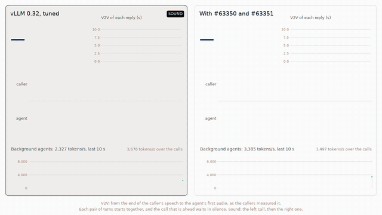

# Leaseholder

[](https://github.com/StevenWang-CY/leaseholder/actions/workflows/ci.yml)

**A realtime voice agent and background agents on one GPU.** A self-hosted voice agent (speech to text, an LLM, text to speech) leaves its GPU idle most of the time, and background LLM work could use the gaps: coding agents, post-call summaries, batch jobs. On stock vLLM that costs the voice agent its latency. A waiting voice turn cannot take KV cache from running background requests, and once it runs, their prefill shares every step of its reply. Leaseholder measures this end to end on one RTX 5060 Ti against what an operator can deploy today, and fixes it in vLLM's scheduler, proposed upstream as [#63350](https://github.com/vllm-project/vllm/pull/63350) and [#63351](https://github.com/vllm-project/vllm/pull/63351).



The first two turns of a call on each configuration, beside 24 coding-agent sessions on the same GPU: tuned vLLM 0.32 (left) answers the second after 10.8 s, vLLM with #63350 and #63351 (right) after 1.6 s. The 75-second video, with sound, is in the [v0.3 release](https://github.com/StevenWang-CY/leaseholder/releases/tag/v0.3).

| Two calls beside 24 sessions of the longest-context coding-agent traces, whose KV fills the pool, on one RTX 5060 Ti (vLLM 0.32, Qwen3-4B-FP8) | Voice-to-voice p95 | Agent tokens/s | Agent TTFT p99 |
|---|---:|---:|---:|
| Voice alone | 1.77 s | — | — |
| Stock vLLM, tuned: priority scheduling, a 512-token step cap | 10.1 s | 3,710 | 99 s |
| The best arm without an engine change: abort background work before its first byte and resubmit it | 2.59 s | 3,630 | 160 s |
| **vLLM with #63350 and #63351**, a 48-token window | **2.19 s** | 3,493 | 97 s |
| Leaseholder's arm 9: the engine change with a 16-token window and a KV reserve, its gateway policy capping every reply at 16 tokens | 2.06 s | 3,411 | 103 s |

Medians of five runs (three for the PRs' configuration); the SLO is voice alone plus 250 ms, 2.02 s. The scenario is E2's discriminating one, a saturated pool: its agents wait about a minute for a first token at the median (65 s on stock vLLM). [BENCHMARKS.md](docs/BENCHMARKS.md#voice-under-agent-load-e2) has every configuration with its runs and range, [docs/PRODUCTION.md](docs/PRODUCTION.md) the configuration to deploy, what to watch and how it fails, and [docs/METHODS.md](docs/METHODS.md) how it was all measured.

What the measurements say:
- **The voice turn loses its seconds waiting for the LLM's first sentence**: 3.8 s of a 5.2 s mean turn on stock vLLM, against 0.3 s alone. Endpointing and TTS barely move.
- **Nothing deployable fixes it in the engine today.** vLLM's priority scheduling with any step cap, its pending request-count preemption (#54530) and SGLang's priority preemption, with or without its host tier, leave the p95 between 8.8 and 12.1 s. A static KV reservation halves it; a router that aborts and resubmits background work brings it to 2.6 s, at the cost of the agents' tail.
- **The scheduler change brings it from 10.1 s to 0.18 s over the SLO (0.15–0.27 s over three runs).** A waiting voice turn preempts lower-priority requests for KV (#63350), whose KV was written through to the CPU tier as it was computed (how much of it a victim reloads, and how much it recomputes, E2 did not measure), and lower-priority prefill sits out the steps of the turn's first tokens (#63351). The second part is the necessary one: #63350 alone stops at 5.8 s. The window has to cover the reply's first sentence: at 16 tokens full replies leave 3.2 s, at 48 the p95 is 2.2 s.
- **A control plane in front cannot make room; only the engine can.** Leaseholder was built to time the protection from the conversation: KV headroom held from speech onset, a prefill throttle while a turn is answered, events from the voice agent. With agents' KV filling the pool these mechanisms could not act. A gateway can only defer new requests, so the headroom was never there (every reply was capped) and the throttle deferred nothing. In front of stock vLLM the same policy leaves voice where stock does (11.0 s). Whether timing helps where its mechanisms do engage was not isolated. The simulator's result for prefetching agents' KV before their tools return is negative too (E1).
- **Where the KV pool has room, the change does not help, and nothing tested meets the SLO.** At the standard scenario's realistic load (16 session trees of the whole corpus) every configuration misses it, the best by about 0.1 s, and three runs each detect no difference between the change (2.20 s) and stock vLLM (2.32 s).

## The problem, measured on one RTX 5060 Ti 16 GB

| | vLLM 0.32, Qwen3-4B-FP8, the frozen box (W1, 2026-10-22) |
|---|---|
| Resuming a 16k-token agent turn | **97 ms** from the GPU cache · **509 ms** restored from host RAM · **3.26 s** recomputed |
| GPU KV pool with speech-to-text, LLM and text-to-speech co-located | **36,400 tokens**: two or three agent contexts |
| One voice turn on the server (STT → first LLM sentence → first TTS audio), p50 | **589 ms** idle · **1,261 ms** beside one stream of cold 8k-token agent prefills · **2,279 ms** beside two |
| What stock priority scheduling does about it | vLLM preempts among running requests, but a waiting voice turn cannot preempt running work when the KV cache is full ([#40004](https://github.com/vllm-project/vllm/issues/40004)) |
| What a control plane in front costs | `lh-gateway` adds **0.38 ms** to a voice request's first token: the paired median against the engine's own socket (W1 build, on cyan) |

The frozen box is the one pinned configuration every experiment runs on: the LLM, STT and TTS servers sharing the GPU. More numbers are in [docs/BENCHMARKS.md](docs/BENCHMARKS.md).

## How it works

```text
 voice: LiveKit worker ──┐                                           agent replay (AIPerf) ──┐
 speech · turn · barge-in                                              background class      │
                         ▼                                                                   ▼
          ┌─────────────────────────────── lh-gateway (Rust) ───────────────────────────────┐
          │ tenants → classes → engine priority · SSE relay with cancellation · metrics     │
          │ admission policies: E2's baselines and Leaseholder's lifecycle-timed policy     │
          │ voice lifecycle events · sessions placed on GPU nodes, sticky                   │
          └────────────────────────────────────────┬─────────────────────────────────────────┘
                                                   ▼
     vLLM 0.32 + make-room: KV preemption for a waiting high-priority request · its first tokens'
     prefill cap · priority scheduling · step cap · write-through CPU KV tier (20 GiB)
     + Whisper (STT) and Kokoro (TTS) on the same 16 GB GPU
```

- **The engine decides the voice turn.** The `make-room` variant changes vLLM 0.32's scheduler in three switches, generated from the installed vLLM's source at each start without modifying it: KV preemption for a waiting request of a higher priority, the prefill cap on its first tokens, and a KV reserve for priority 0. The first two are proposed upstream; the reserve stays in the variant, and with full replies E2 found the two equivalent (2.20 s with the reserve, 2.19 s with the KV preemption).
- **The control plane is a harness.** `lh-gateway` maps tenants to classes and classes to engine priorities, relays streams with cancellation, and runs the admission policies E2 compares, Leaseholder's own lifecycle-timed policy among them. It is how the experiments are run, not what a deployment needs: the measured configuration sends the priority and nothing else.
- **Realtime is never shed.** The engine makes room for a voice turn; under arm 9's policy the gateway caps its reply instead of refusing it.
- **KV never crosses the network.** Sessions stick to the node that holds them. Every service binds loopback; hosts talk over SSH tunnels; the voice plane runs in a network namespace with no route out.

The name is the original design's, in which the control plane held leases on sessions' KV; that design also had prefetch and a recompute ledger, and after E1 and E2 all three were dropped ([ADR-0006](docs/adr/0006-the-engine-change-carries-the-realtime-tier.md)). [docs/ARCHITECTURE.md](docs/ARCHITECTURE.md) describes what is built, what was tested and not adopted, and why.

## Status

As of 2026-10-24 (v0.3; main has since removed the unused lease code):

| Component | State |
|---|---|
| Frozen box on the GPU node: vLLM 0.32 LLM + Whisper STT + Kokoro TTS, pinned environment, NUMA-pinned `systemd --user` units, smoke test | **Deployed** on Phastform, and on Gray, the identical second node, for booked windows; paused when idle ([`deploy/phastform`](deploy/phastform), [`deploy/gray`](deploy/gray)) |
| Engine variants for E2: vLLM #54530 ported to 0.32.0, SGLang 0.5.22, CUDA MPS, engine flags from an arm file, and `make-room`, Leaseholder's scheduler change for priority scheduling under KV pressure (#40004), generated from vLLM's source with three switches | **Deployed** ([`deploy/phastform/variants`](deploy/phastform/variants)); `make-room` tested on vLLM's real scheduler, probed on the GPU (4.9–5.1 s → 0.22–0.30 s to a voice turn's first token behind two 18k-token agent requests, [the KV case](docs/BENCHMARKS.md#the-kv-case-make-room)) and measured in E2 |
| Control host: restricted SSH tunnels, `lh-gateway`, and LiveKit with the voice agent in a network namespace with no route out; SMG for one E2 arm | **Deployed** ([`deploy/cyan`](deploy/cyan)) |
| `lh-proto`: lifecycle events, headers, SLO classes and sessions, with JSON Schemas | **Built** ([`crates/lh-proto`](crates/lh-proto)) |
| `lh-core`: the tier cost model, KV geometry, the step-time model fitted on the frozen box, and the admission state machine with E2's baseline policies (static cap, token reservation, llm-d flow control emulated, preempt-resubmit) and Leaseholder's own, `leaseholder`: KV headroom for armed voice sessions, a critical-window prefill budget priced by the step model, degrade and aging; the placement policies for several GPU nodes (`dedicated`, `least-loaded`, `leaseholder`) | **Built** ([`crates/lh-core`](crates/lh-core)) |
| `lh-gateway`: auth, sanitization, sessions and classes, SSE relay with cancellation and backpressure, lifecycle-event ingest with each voice session's turn state, metrics, and an admission point running `lh-core`'s policies, with the class sent upstream as vLLM's priority header, SGLang's body field or SMG's header; with `[nodes]`, sessions placed and kept on several GPU nodes, each with its own readiness probe and admission point (`POST /v1/sessions`) | **Deployed** on cyan ([`crates/lh-gateway`](crates/lh-gateway)) |
| `lh-sim`: the agent replay through a model of vLLM's two-tier KV cache and its step loop (calibrated within 8% of resume TTFT p50 and p90 at 8 and 16 sessions), with stock arms, E1's information-level arms, a clairvoyant reference and the regime map | **Built** ([`crates/lh-sim`](crates/lh-sim)); E1's result is negative |
| `leaseholder_vllm`: the engine variants' tests, their builds from vLLM's source and `make-room` on vLLM's real scheduler | **Built** ([`python/leaseholder_vllm`](python/leaseholder_vllm)); the lease-aware CPU-tier `CachePolicy` and connector it held, live-checked on the GPU and never used, were removed after v0.3 |
| `leaseholder_bench`: block-scaled Claude Code traces, AIPerf loader and endpoint plugin, KV lifecycle comparison, tier and voice-turn probes, and `lh-bench e2`, the E2 harness (arm files, campaigns, per-point summaries with exact first bytes, the stage waterfall and the GPU's clocks, the frontier report with repeats, compact records and `make reproduce-e2`), points on two GPU nodes with each node's share | **Built** ([`python/leaseholder_bench`](python/leaseholder_bench), [`benchmarks/e2`](benchmarks/e2)); E2's 129 points on one node are committed ([records](benchmarks/results/2026-10-23-e2)) |
| `leaseholder_voice`: the voice agent (`lh-voice-worker`) with its lifecycle events and per-turn stage times, measurement callers that read latency from waveforms and can record a call (`lh-voice bots`), LiveKit plugin factory, barge-in test; a call's STT and TTS on its GPU node | **Deployed** on cyan ([`python/leaseholder_voice`](python/leaseholder_voice)); the calls of every E2 point, and voice alone five times as the SLO's reference |

The experiments are in [docs/EXPERIMENTS.md](docs/EXPERIMENTS.md). E2, the voice SLO against tuned stock vLLM and every deployable alternative while background agents run, is complete on one GPU node; its two-node points (dedicate vs pool) wait for a window on Gray.

## Quickstart

Development needs Rust 1.98, uv and Python 3.12. No GPU is required.

```sh
make check                                         # lint and every test CI runs (below)
make schema                                        # regenerate crates/lh-proto/schema after changing a wire type
VLLM_SRC=~/src/vllm-v0.32.0 make test-vllm         # the engine variants' tests against an existing vLLM checkout
make reproduce-e2                                  # E2's report, tables, frontiers and waterfall from the committed records
make e2-figures                                    # the docs' E2 figures from the same records
make reproduce-e1 CORPUS=DIR                       # E1's tables with lh-sim, from the 32x corpus in DIR
make reproduce-calibration EXPORTS=DIR CORPUS=DIR  # lh-sim's calibration, from six measured runs' exports
```

`make check` runs rustfmt, clippy and ruff, the Rust tests, the engine variants' build tests against vLLM's scheduler source (in a sparse vLLM v0.32.0 checkout it clones once into `~/.cache/leaseholder`), and the Python unit tests. `make reproduce-e2` rebuilds E2's report from the compact records of its 129 points, the same files as from the run directories. `make reproduce-e1` rebuilds E1's tables in about a minute from the 32× corpus, which stays outside the repository ([how to build it](crates/lh-sim/README.md#usage)). `make reproduce-calibration` recomputes the simulator's calibration from the exports of the six runs it was fitted and validated on, an asset of the [v0.3 release](https://github.com/StevenWang-CY/leaseholder/releases/tag/v0.3). Deploying to the hosts is in [ops/RUNBOOK.md](ops/RUNBOOK.md#deploy).

## Repository layout

```text
crates/lh-proto/          wire types and their JSON Schemas
crates/lh-core/           the cost and step-time models and KV geometry, shared with the simulator; admission and placement policies
crates/lh-gateway/        the control-plane service in front of vLLM, with its overhead benchmark
crates/lh-sim/            the KV cache simulator: AIPerf's replay, vLLM's two tiers, policy arms
python/leaseholder_vllm/  the engine variants' tests: their builds from vLLM's source, make-room on the real scheduler
python/leaseholder_bench/ trace conversion, AIPerf plugins and configs, latency probes, the E2 harness
python/leaseholder_voice/ the voice agent, measurement callers, LiveKit integration and its hermetic barge-in test
benchmarks/               E2's arm files and campaigns, the committed records, and runs against upstream projects
deploy/                   per-host bootstrap, systemd units, engine variants, tunnels, smoke test
ops/                      the runbook; dashboards and alert rules are planned
docs/                     architecture, protocol, SLOs, experiments, benchmarks, production guide, methods, prior art, ADRs, figures
```

## Why not llm-d, Dynamo or vllm-project/router?

- **Most mechanisms already ship.**
  - llm-d v1.0 has flow control with priority bands, holdback ceilings, SLO-deadline ordering and in-flight eviction of sheddable requests.
  - SMG, a Rust gateway, reserves slots per priority class and preempts lower classes before their first byte.
  - Dynamo queues by priority but does not reserve capacity.
  - vllm-project/router admits agent Programs with a logical KV TTL.
  - In the engines, vLLM and SGLang preempt by priority, but neither lets a waiting request preempt running work when the KV cache is full.

  Leaseholder claims none of these. llm-d flow control (emulated), SMG and both engines' priority preemption are baselines it is measured against, and in the discriminating scenario none of them meets the voice SLO.
- **What it adds:**
  - a change to vLLM's priority scheduling for a full KV cache: a waiting request preempts lower-priority running work, which resumes from the CPU tier, and lower-priority prefill sits out its first tokens (#63350 and #63351; SGLang's counterpart is its own draft, #45686);
  - E2: the voice SLO measured end to end, from waveforms, against every deployable alternative, with single-mechanism ablations, five repeats and each turn's stages;
  - measured negatives: lifecycle-timed headroom and throttling beside that change (E2), lifecycle-informed retention and prefetch of agents' KV (E1).
- **The gateway is a harness.** `lh-gateway` is a small Rust proxy for experiments on one GPU without Kubernetes. It does not compete with fleet routers. What goes where production runs:
  - the engine change, as two vLLM scheduler PRs under #40004: [#63350](https://github.com/vllm-project/vllm/pull/63350) lets a waiting request preempt lower-priority work for KV, and [#63351](https://github.com/vllm-project/vllm/pull/63351) holds lower-priority prefill out of its first tokens;
  - E1's negative result for agent-side retention and prefetch, on vLLM #57103 and vllm-project/router #428;
  - agentic-api's benchmark sweep ([#478](https://github.com/vllm-project/agentic-api/pull/478)), and the lifecycle-event sink and cache-control pass-through proposed there (#364, #330).

  None of these is merged yet.

See [docs/PRIOR-ART.md](docs/PRIOR-ART.md) for sources and status.

## License

Apache-2.0
