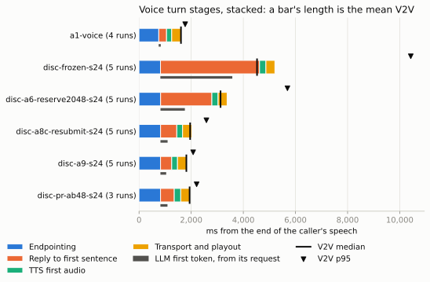

# Benchmarks

What has been measured from W1 to W4, on one RTX 5060 Ti 16 GB (sm_120, PCIe Gen3 x8) in Phastform: two Xeon E5-2609 v4 at 1.7 GHz, 188 GiB RAM, vLLM 0.32.0. The numbers come from the frozen box ([`deploy/phastform`](../deploy/phastform)), the `lh-bench` probes and the E2 harness in this repository, run from cyan through the SSH tunnel as the control plane reaches the engine; the make-room probes ran on Gray, the identical second box. Earlier probe numbers are kept only where W1 has not re-measured them, and are marked.

## The frozen box

| | Value |
|---|---|
| GPU KV pool | 36,400 tokens, fixed at 5 GiB (32k context) |
| CPU tier | 20 GiB in `/dev/shm`: 17.35 GiB on NUMA node 1 (GPU-local), 2.65 GiB spilled to node 0. In the earlier probe, a remote NUMA node cost at most 1% of pinned bandwidth |
| GPU memory, all three servers idle | 14,408 / 16,311 MiB |
| GPU memory, stress peak (LLM c=16, 30k prefill, STT c=4, TTS c=4) | 14,086 / 16,311 MiB in the earlier probe; no OOM, no preemption |
| Cold start, first boot (includes a one-time FlashInfer JIT) | 7.5 min for all three servers |
| Engine restart with warm caches | about 2 min |

## Tier cost model: resuming an agent turn (E0)

`lh-bench tiers` sends a unique prompt of L random token ids three times, each asking for one token: cold (recomputed), again at once (a GPU prefix-cache hit), and after other prompts pushed it out of the GPU pool (restored from the CPU tier). vLLM's prefix-cache counters, read around each request, verify where its tokens came from; no sample of these runs was invalid. Time to first token (TTFT), p50 of 5 samples, frozen box (Qwen3-4B-FP8, audio servers resident, 36,400-token pool, 20 GiB write-through CPU tier, step cap 512/256), 2026-10-22:

| Prompt tokens | Recomputed | GPU hit | Restored from host RAM |
|---|---|---|---|
| 1,024 | 135 ms | 45 ms | 64 ms |
| 2,048 | 198 ms | 40 ms | 95 ms |
| 4,096 | 437 ms | 48 ms | 157 ms |
| 8,192 | 1,114 ms | 64 ms | 281 ms |
| 16,384 | **3,264 ms** | **97 ms** | **509 ms** |
| 24,576 | 6,506 ms | 128 ms | 722 ms |
| 31,744 | 10,239 ms | 156 ms | 903 ms |

**Fitted model** (`lh-core`'s defaults):
- GPU hit ≈ 35 ms + 3.8 µs/token;
- a CPU restore adds ≈ 10 ms + 23.6 µs/token over a GPU hit (about 6.2 GB/s of KV at 144 KiB/token), the same slope as the earlier BF16 probe;
- recompute ≈ 48 ms + 63 µs/token + 8.1 ns/token², the quadratic term being attention. The 512-token step cap that protects decode latency makes cold prefill slower than an uncapped engine.

Restoring beats recomputing at every measured length (from 1,024 tokens). In the dimensionless terms E1 uses, `lh-sim` takes the restore time from these fits as what a restore adds over a GPU hit. At the 8k median prompt, ρ = restore / recompute ≈ 0.18. π = the median pause / restore depends on which pause:
- Copilot's median tool call (166 ms) gives about 0.8;
- the W0 replay window's median think time (1.6 s, at its 3.4k median prompt) gives about 18.

**Under contention** (p50; same probe while background load runs):

| Prompt tokens | Background | Recomputed | GPU hit | Restored |
|---|---|---|---|---|
| 1,024 | 8 decode streams (1k prompt, 1k output) | 200 ms | 131 ms | 173 ms |
| 16,384 | 8 decode streams | 4,528 ms | 186 ms | 592 ms |
| 1,024 | one stream of cold 8k prefills | 342 ms | 283 ms | 263 ms |
| 16,384 | one stream of cold 8k prefills | 5,230 ms | 387 ms | 728 ms |

- **Decode load** adds a roughly constant ~85 ms to a GPU hit and to a restore (the probe shares steps with the decode batch); the restore slope is unchanged, so PCIe is not the bottleneck.
- **Prefill load** is worse. Even a GPU-cached 1k prompt waits ~250 ms behind the running chunked prefill, and recompute slows 1.6–2.5×. This is the compute-interference path that a critical-window prefill throttle targets.

The earlier probe (2026-10-21, BF16 weights, no audio servers) measured 0.18 s / 0.57 s / 4.75 s at 16k for GPU hit / restore / recompute.

## Voice on the shared GPU

`lh-bench voice-turn` runs the cascade a voice agent runs, against the frozen box through the tunnel:
1. the caller's utterance goes to STT (LibriSpeech clips of 2.0 and 3.2 s);
2. the transcript is streamed through the LLM at the realtime priority;
3. the first sentence goes to TTS as soon as it is complete. A sentence counts once it reaches 20 characters, LiveKit's default.

The turn runs from sending the audio to the first byte of TTS audio. That is the server-side share of voice-to-voice latency: endpointing, the network and playout come on top. 30 turns per row, p50 / p90 in ms (W1, 2026-10-22):

| Background agent load | STT | LLM first token | LLM first sentence | TTS first audio | **Turn** | Background prefill |
|---|---|---|---|---|---|---|
| None | 160 / 168 | 49 / 51 | 251 / 319 | 176 / 187 | **589 / 665** | — |
| One stream of cold 8k-token prefills | 233 / 240 | 172 / 197 | 807 / 937 | 226 / 251 | **1,261 / 1,413** | 6,220 tokens/s |
| Two streams | 233 / 248 | 565 / 1,207 | 1,802 / 2,113 | 231 / 254 | **2,279 / 2,593** | 6,966 tokens/s |

- **The LLM's first sentence carries most of the damage.** Decode steps for the voice request share the GPU with 512-token prefill chunks, so the inter-token gap stretches. The co-located STT and TTS slow by up to 46% and 31% (time-slicing between processes).
- **MPS does not fix it.** With the three servers as clients of one MPS daemon (variant `mps`):
  - idle turns are unchanged (606 / 669 ms);
  - STT and TTS gain 7–8% under load;
  - beside one prefill stream, the turn gets worse (1,403 / 2,061 ms) and background prefill throughput drops 13%;
  - beside two streams it is mixed (2,042 / 2,870 ms).

  The interference that matters is inside the engine, so the frozen box stays on time-slicing, and an MPS split is kept as an equal-hardware arm of E2.

**End to end, from waveforms.** `lh-voice bots` places calls through LiveKit (2 callers, 25 turns each, a barge-in on 25% of turns) to the stock voice agent (`lh-voice-worker`). Voice-to-voice (V2V) runs from the end of the caller's speech to the agent's first audio, read at the caller on one clock (W1, 2026-10-22; the LLM path goes straight to the engine):

| Setup | V2V p50 | p95 | p99 | Barge-in to silence p50 / p95 |
|---|---|---|---|---|
| Voice alone, LiveKit's end-of-turn model | 1,646 ms | 3,226 ms | 3,444 ms | 637 / 686 ms |
| Voice alone, fixed endpointing (experiments) | **1,614 ms** | **1,760 ms** | **1,889 ms** | 634 / 696 ms |
| Beside the agent replay (16 session trees, 1.3 requests/s), fixed endpointing | 1,664 ms | **2,312 ms** | 3,013 ms | 563 / 687 ms |

- **Endpointing dominates voice alone.** About 1 s of each turn is endpointing (VAD end of speech plus LiveKit's 0.5 s minimum); the server-side turn is the rest.
- **The end-of-turn model adds a 3 s mode.** It judged about one line in six from the synthesized callers unfinished and waited for its 3 s maximum. Experiments therefore end turns a fixed delay after speech (the `vad-turns` variant), the same for every arm.
- **Agent load breaks the voice SLO.** Beside a realistic agent replay, V2V p95 rises by 552 ms and p99 by 1.1 s, against an SLO of at most +250 ms. Agent TTFT stayed 149 ms p50 and 11.2 s p99.
- **Nothing ran out of memory.** GPU memory held at 14.05 GiB, and neither the calls (50 turns) nor the replay (507 requests) had an error.

**A barge-in closes the LLM stream** (W0: LiveKit Agents 1.8.8 with mock STT, LLM and TTS, in the voice-plane namespace on cyan, [`python/leaseholder_voice`](../python/leaseholder_voice), 10 runs). Measured from the caller's barge-in onset to the LLM server seeing the disconnect:
- 2.19 s median with the stock handling, which pauses the reply audio and interrupts it on the barge-in's final transcript;
- 0.58 s with `resume_false_interruption=False`, which interrupts after 0.5 s of speech.

In stock mode the reply keeps streaming for the whole barge-in.

**Earlier probe** (2026-10-21/22, 8-character first sentence):
- the server-side turn took 415 ms idle and 876 ms median under 8k prefills;
- Whisper large-v3-turbo on vLLM took 144 / 166 / 221 ms for 2 / 5 / 10 s utterances at concurrency 1;
- Kokoro-82M reached first audio for one sentence in 154–179 ms.

## Voice under agent load (E2)

Each point: two callers (`lh-voice bots`, 25 turns each, a barge-in on a quarter of the turns) through LiveKit to the stock voice agent, beside the AIPerf replay of the 32× Claude Code corpus at a number of session trees, through `lh-gateway` ([EXPERIMENTS.md](EXPERIMENTS.md#e2-voice-under-agent-load) has the arms, [`benchmarks/e2`](../benchmarks/e2) the arm files and campaigns). V2V is read from waveforms at the callers, with fixed endpointing. Background goodput is the prompt and completion tokens per second of the agent requests that completed during the calls. The realtime first byte is the gateway's, exact from its request log. The voice SLO is V2V p95 at most 250 ms above voice alone: 1,744 ms alone in W2's batch, so 1,994 ms for W2's tables, which are one run per point. With 50 turns a point, a p95 lies between the third- and fourth-largest turn, so single runs differ by a few hundred milliseconds at p95. W4 repeats the discriminating scenario and measures voice alone five times (median 1,767 ms, so an SLO of 2,017 ms), below the W2 tables.

**The standard scenario** (the whole corpus), W2, 2026-10-22/23, on the W2 build. V2V p95 and, in brackets, the realtime first byte p95, in ms:

| Session trees | Background tokens/s | Arm 2: stock (FCFS, 2,048-token chunks) | Arm 3: + priority | Arm 4: + step cap 512/256 (the frozen box) | Arm 7b: SGLang 0.5.22 |
|---|---:|---:|---:|---:|---:|
| 0 (voice alone) | 0 | 1,744 (96), frozen box | | | |
| 8 | 2,700–2,800 | 1,886 (114) | 1,871 (80) | — | 3,228 (1,440); with HiCache 1,822 (97) |
| 16 | 5,000–5,600 | 2,406 (446) | 2,400 (333) | 2,215 (224) | 8,477 (2,284); with HiCache 2,218 (249) |
| 24 | 9,200–9,600 | 3,008 (1,280) | 4,360 (2,243) | 3,865 (542) | — |

At 16 session trees, every arm (V2V p50 / p95 / p99 in ms; the realtime first byte p95; background tokens/s):

| Arm | Point | V2V p50 / p95 / p99 | First byte p95 | Background tokens/s | Notes |
|---|---|---:|---:|---:|---|
| 4 | frozen box: step cap 512, long-prefill threshold 256 | 1,736 / 2,215 / 2,925 | 224 | 5,068 | |
| 4 | step cap 1,024, no threshold | 1,687 / 2,167 / 2,479 | 144 | 5,246 | the best cell; within noise of the frozen box |
| 4 | other cells (512/0, 1,024/256, 1,024/512) | 1,703–1,724 / 2,257–2,510 / 2,504–2,684 | 178–273 | 5,015–5,097 | |
| 5 | `--watermark 0.1` | 1,703 / 2,495 / 2,986 | 216 | 5,001 | |
| 5 | `--max-num-queued-tokens 8192` | 1,693 / 2,053 / 2,173 | 137 | 4,454 | 2 of 50 voice turns failed: the limit refuses realtime requests too (43 refusals) |
| 6 | static cap, 2 background in flight | 1,755 / 2,208 / 2,729 | 236 | 5,569 | the highest goodput |
| 6 | static cap, 8 | 1,683 / 3,065 / 3,647 | 510 | 5,296 | |
| 6 | static reservation, 2,048 tokens | 1,688 / 2,328 / 3,068 | 276 | 4,922 | |
| 7a | `--max-num-seqs 12` | 1,710 / 2,104 / 2,984 | 161 | 4,981 | |
| 7a | `--max-num-seqs 12` with #54530 | 1,728 / 2,736 / 3,103 | 461 | 4,897 | |
| 7b | SGLang 0.5.22, priority preemption | 1,882 / 8,477 / 9,458 | 2,284 | 5,543 | no host tier: half its prompt tokens hit, against about 90% for vLLM with its CPU tier |
| 7b | SGLang with HiCache (4×, written through) | 1,720 / 2,218 / 4,088 | 249 | 4,924 | the host tier, for parity with vLLM's |
| 8a | llm-d flow control, emulated (ceilings 6/6/6) | 1,768 / 2,468 / 2,821 | 216 | 5,413 | 1 background request shed |
| 8b | SMG 1.13.0, as shipped | 1,723 / 2,202 / 3,255 | 237 | 5,545 | |
| 8c | preempt-resubmit before the first byte | 1,678 / 2,520 / 2,711 | 235 | 5,090 | 11 resubmissions |
| factor | frozen box, preemptive generation off | 1,687 / 2,278 / 2,953 | 294 | 5,121 | |
| calls | frozen box, 4 callers / 6 callers | 1,747 / 2,599 / 3,135 · 1,735 / 2,670 / 3,471 | 428 · 413 | 5,296 · 5,067 | 4 callers alone: 1,655 / 2,017 / 2,110 |

What the standard scenario says:
- **At 8 session trees every vLLM arm measured in W2 holds the voice SLO** (1,871–1,886 ms against 1,994). SGLang does not (3,228 ms).
- **At 16, the realistic operating point, none clearly does, and the arms are within noise of each other.** The best stock cell, `--max-num-seqs 12`, SMG and the static cap of 2 land at 2,104–2,215 ms, 100–220 ms above the SLO; `--max-num-queued-tokens` lands under it only by refusing work, voice turns included. No gateway policy or engine knob separates itself from tuned stock here.
- **The step cap shows in the realtime first byte, not in V2V.** At 24 session trees, priority scheduling alone gives a first-byte p95 of 2,243 ms and the 512/256 step cap 542 ms, but V2V p95 is 4,360 against 3,865 ms: the rest of the turn, decoding to the first sentence and TTS, still shares the GPU with agent prefills. No arm holds the SLO at 24.
- **SGLang's deficit was its missing host tier.** Without one it is the worst arm at every load; with HiCache, written through like vLLM's CPU tier, it matches vLLM: 1,822 ms at 8 session trees and 2,218 ms at 16, against the frozen box's 2,215 ms.
- **Preemptive generation off** changes nothing measurable (2,278 against 2,215 ms), and **more callers** cost what they cost alone and some: four callers beside 16 session trees reach 2,599 ms against 2,017 ms alone.

**The discriminating scenario** (W2's third batch, 2026-10-23, on the W3 build like everything after it): 24 session trees of the 48 traces with the largest contexts (`weka-x32-long`, a median of 13.3k tokens a request), beside the same two callers, one run per point. The pool holds two or three of these contexts, and the agents' working set is far beyond both tiers: under the frozen box about 95% of their prompt tokens are computed, and agents wait about a minute for a first token under every arm. It is the regime where running agent KV fills the pool. V2V p50 / p95 / p99 and the realtime first byte p95 in ms; background tokens/s:

| Arm | Point | V2V p50 / p95 / p99 | First byte p95 | Background tokens/s | Notes |
|---|---|---:|---:|---:|---|
| 4 | frozen box | 4,270 / 10,811 / 12,427 | 8,556 | 3,703 | |
| 4 | step cap 1,024, no threshold | 4,816 / 8,789 / 10,024 | 6,523 | 4,097 | |
| 5 | `--watermark 0.1` | 4,843 / 10,647 / 13,583 | 8,201 | 3,712 | |
| 5 | `--max-num-queued-tokens 8192` | 1,797 / 2,013 / 2,032 | 56 | 5,597 | 48 of 50 voice turns failed: 1,132 requests refused, voice turns among them |
| 6 | static cap, 2 / 8 background in flight | 3,363 / 8,573 / 10,385 · 5,713 / 9,876 / 11,369 | 6,320 · 7,502 | 3,566 · 3,785 | |
| 6 | static reservation, 2,048 tokens | 3,311 / 5,706 / 6,317 | 3,631 | 3,633 | |
| 7a | `--max-num-seqs 12` with #54530 | 4,687 / 10,930 / 11,870 | 7,964 | 3,718 | |
| 7b | SGLang 0.5.22, priority preemption | 5,367 / 12,051 / 17,937 | 6,451 | 3,678 | |
| 7b | SGLang with HiCache (4×, written through) | 4,274 / 10,497 / 13,193 | 5,000 | 4,908 | |
| 8a | llm-d flow control, emulated | 4,221 / 10,992 / 11,277 | 8,172 | 4,006 | 60 background requests shed |
| 8b | SMG 1.13.0 | 3,511 / 11,050 / 13,839 | 8,783 | 3,557 | |
| 8c | preempt-resubmit before the first byte | 1,960 / 2,591 / 2,684 | 374 | 3,901 | 1,080 resubmissions; agent TTFT p99 140 s |

The voice turn by stage (means over the replies, ms; `waterfall.svg` draws them):

| Point | Endpointing | Reply to first sentence | TTS first audio | Transport and playout | Mean V2V | LLM first token |
|---|---:|---:|---:|---:|---:|---:|
| frozen box | 827 | 3,651 | 276 | 326 | 5,080 | 2,701 |
| static reservation, 2,048 tokens | 830 | 2,173 | 250 | 351 | 3,604 | 1,068 |
| preempt-resubmit | 827 | 627 | 223 | 358 | 2,034 | 265 |

What the discriminating scenario says:
- **Every arm but one collapses, and the loss is the wait for KV.** V2V p95 is 5.7–12.1 s. Endpointing and TTS do not move; the turn loses its seconds between the end of the turn and the first sentence, most of them before the LLM's first token.
- **Engine priority does not help here**, in any form measured: vLLM's priority scheduling with any step cap, #54530 (it preempts at the request-count cap, which does not bind here), SGLang's priority preemption, with or without its host tier. SGLang's host tier lifts agent goodput by a third, not the voice tail.
- **Static answers help or cheat.** The 2,048-token reservation halves the tail (5.7 s), still 3.7 s over the SLO; concurrency caps do not help, because two contexts fill the pool. vLLM's queue limit meets the SLO only by refusing the voice turns.
- **Preempt-resubmit holds the tail** at 2.6 s p95, 0.6 s over the SLO, at the frozen box's goodput: it aborts the background requests that have no first byte yet, which frees their KV at once, and their resubmissions restore the prefixes already written through to the CPU tier rather than recompute them (the engine computed 0.65M prompt tokens and restored 0.62M, against 1.48M and 0.06M under the frozen box). Its cost is the agents' tail. It cannot reach a request that is already decoding, which an engine-side preemption can (arm 9).
- **An instrument note.** vLLM counts a preemption when the victim's next output reaches the frontend, so the per-point preemption counts are lower bounds ([the KV case](#the-kv-case-make-room)).

**The discriminating scenario, repeated, with arm 9 and the engine change** (W4, 2026-10-23/24). In rounds: w2c and a9 are round 0, `r1`–`r4` repeat it, each round grouping its points by engine and rotating the groups' order, so that no configuration always runs at the same hour. Every headline configuration has five runs, each of arm 9's ablations and each configuration of the vLLM PRs three, and voice alone, the SLO's reference, five (1,744–1,805 ms, median 1,767 ms, so the SLO is 2,017 ms). All on the same build; [`benchmarks/e2`](../benchmarks/e2/README.md) lists the campaigns. The median of the runs, and for V2V p95 its range:

| Configuration | Runs | V2V p50 / p95 / p99 | p95 range | First byte p95 | Background tokens/s | Agent TTFT p99 |
|---|---:|---:|---:|---:|---:|---:|
| Voice alone | 5 | 1,611 / 1,767 / 1,799 | 1,744–1,805 | 66 | — | — |
| The frozen box | 5 | 4,520 / 10,138 / 12,110 | 9,257–10,811 | 7,834 | 3,710 | 99 s |
| Step cap 1,024, no threshold | 5 | 4,348 / 8,789 / 10,024 | 8,161–9,490 | 6,523 | 4,097 | 85 s |
| Static reservation, 2,048 tokens | 5 | 3,127 / 5,671 / 6,681 | 4,906–5,798 | 3,190 | 3,564 | 102 s |
| SGLang with HiCache | 5 | 4,705 / 11,948 / 18,063 | 9,394–16,702 | 8,012 | 4,723 | 82 s |
| Preempt-resubmit before the first byte | 5 | 1,960 / 2,591 / 2,684 | 2,110–2,663 | 374 | 3,630 | 160 s |
| **Arm 9**, every reply capped at 16 tokens | 5 | 1,825 / **2,057** / 2,139 | 1,980–2,134 | 290 | 3,411 | 103 s |
| #63350 alone (KV preemption) | 3 | 3,246 / 5,773 / 8,110 | 5,612–6,063 | 2,785 | 3,633 | 97 s |
| #63350 + #63351 (the budget cap, 16 tokens) | 3 | 1,986 / 3,229 / 4,135 | 3,220–4,772 | 338 | 3,568 | 100 s |
| **#63350 + #63351, a 48-token window** | 3 | 1,943 / **2,193** / 2,281 | 2,168–2,286 | 372 | 3,493 | 97 s |

The PR configurations run the engine as the PRs propose it, without the reserve, behind the gateway without an admission policy and with full replies. Arm 9 without one part at a time, three runs each (V2V p95, median and range, ms):

| Arm 9 without | V2V p95 | Range | | Arm 9 without | V2V p95 | Range |
|---|---:|---:|---|---|---:|---:|
| the critical-window throttle | 2,049 | 1,995–2,081 | | degrade | 3,837 | 2,890–4,079 |
| the headroom | 2,033 | 1,947–2,071 | | degrade, with a 48-token window | 2,205 | 2,098–2,289 |
| the lifecycle events | 2,036 | 2,005–2,048 | | the gateway policy (engine only) | 4,034 | 2,984–4,062 |
| (headroom armed by the request) | 2,124 | 2,008–2,165 | | KV make-room | 2,037 | 1,990–2,039 |
| (budget 0 ms / 500 ms) | 2,109 / 2,060 | 2,094–2,166 / 1,990–2,080 | | the reserve | 2,116 | 2,115–2,155 |
| | | | | the budget cap | 5,295 | 5,063–6,115 |
| | | | | the engine change (gateway only) | 10,993 | 10,028–11,958 |

What the gateway's policy did in each run, as its counters at the end of the calls (60 realtime requests a run, preemptive generation included):

| Configuration | Runs | Headroom deferrals | Critical-window deferrals | Realtime requests degraded |
|---|---:|---:|---:|---:|
| Arm 9 | 5 | 31–45 | 0 | 60 |
| Without the throttle | 3 | 38–52 | — | 60 |
| Throttle budget 0 / 500 ms | 3 each | 39–49 / 39–48 | 0 / 0 | 60 |
| Without the headroom | 3 | — | 1–3 | 60 |
| Headroom armed by the request | 3 | 9–11 | 0 | 60 |
| Without the lifecycle events | 3 | 4–6 | 0 | 60 |
| Without degrade, a 48-token window | 3 | 41–50 | 0 | — |
| The gateway only (stock engine) | 3 | 71–86 | 0 | 60 |
| Standard scenario, 16 / 24 session trees | 3 / 1 | 5–10 / 41 | 0–4 / 27 | 0 / 1 |

The voice turn by stage (means over each configuration's replies, ms):

| Configuration | Endpointing | Reply to first sentence | TTS first audio | Transport and playout | Mean V2V | LLM first token |
|---|---:|---:|---:|---:|---:|---:|
| Voice alone | 757 | 297 | 199 | 352 | 1,605 | 80 |
| The frozen box | 822 | 3,801 | 244 | 343 | 5,211 | 2,760 |
| Static reservation | 827 | 1,967 | 238 | 346 | 3,378 | 935 |
| Preempt-resubmit | 826 | 622 | 222 | 353 | 2,023 | 274 |
| Arm 9 | 824 | 429 | 222 | 354 | 1,830 | 221 |
| #63350 + #63351, 16 tokens | 826 | 914 | 245 | 353 | 2,336 | 265 |
| #63350 + #63351, 48 tokens | 824 | 526 | 249 | 353 | 1,953 | 270 |

The same stages as bars (`make e2-figures`), a row per point of the records: `a1-voice` is voice alone (four runs: its W2 run predates the worker's stage times), `disc-frozen-s24` the frozen box, `a6-reserve2048` the static reservation, `a8c-resubmit` preempt-resubmit, `a9` arm 9 and `pr-ab48` the PRs with a 48-token window. The grey bar is the LLM's first token, from its request.

What the repeats say:
- **The engine change takes the voice tail to the SLO's edge.** With full replies and a 48-token window, the PRs' configuration reaches 2,193 ms (2,168–2,286), 176 ms over the SLO, against the frozen box's 10,138 and preempt-resubmit's 2,591. Arm 9, whose gateway capped every reply at 16 tokens, reaches 2,057 ms: two of its five runs are under the SLO, and its median is 40 ms over it, within one point's spread. No configuration without the engine change has a run under the SLO with every turn answered; vLLM's queued-token limit gets under it by refusing 48 of 50 voice turns.
- **Its budget cap is necessary, and either KV preemption or the reserve suffices.** Without the budget cap the p95 stays at 5.3 s even with KV preemption and the reserve; without KV preemption, or without the reserve, it is within the spread of arm 9's runs. #63350 alone halves the frozen box's tail (5.8 s); with #63351 the turn's first token comes in 338 ms at p95 (frozen 7,834).
- **The reply has to fit the window.** With the 16-token window a full reply's first sentence (20 tokens at the median, 39 at most) outruns it and decodes beside agent prefill again: 3.2–4.0 s whether the gateway runs or not. Degrade, which caps the reply at 16 tokens when the headroom is not there, capped every reply here; a 48-token window covers full replies instead, at 2,193 ms for the PRs alone and 2,205 ms with arm 9's gateway policy and reserve, about 140 ms over arm 9's capped replies: the price of a full reply's longer first sentence (526 against 429 ms).
- **The gateway's lifecycle-timed mechanisms could not act here** (their counters are in the table above). Running agent requests held the pool, which the headroom can protect only by deferring new requests, so it never had its room: degrade capped 60 of 60 realtime requests in every run of arm 9. The critical-window throttle, checked after the headroom, deferred nothing while the headroom ran, even at a 0 ms budget. Room for a voice turn came from the engine alone: without the engine change, the policy leaves voice where stock vLLM does (10,993 ms). So E2 shows that a control plane in front cannot make room while running work holds the KV. Whether lifecycle timing helps where its mechanisms engage (in the standard scenario at 24 session trees the throttle deferred 27 requests) was not isolated.
- **The cost to the agents.** Arm 9 keeps 92% of the frozen box's background goodput and the PRs alone 94%, with the agents' TTFT p99 unchanged (97–103 s against 99 s). Preempt-resubmit keeps 98% but its resubmissions take the agents' p99 to 160 s.
- **Spread.** A configuration near the SLO moves by about 150 ms in p95 from run to run; one that misses it moves by up to 1.5 s (#63350 + #63351 at 16 tokens, 3,220–4,772 ms) and SGLang by 7 s. One run cannot rank configurations that miss.

**The standard scenario, repeated** (the whole corpus, three runs of each at the realistic load of 16 session trees; the frozen box's third run is W2's): arm 9's p95 is 2,196 ms (2,193–2,446) against the frozen box's 2,323 (2,215–2,530), both over the SLO and within noise of each other, at 5,244 and 5,167 tokens/s. Each call's first turn is slower under load (a mean of 2.4–2.5 s against 1.8 s for the later turns) and sets part of this p95: without it, 2,037 and 2,186 ms. Where the pool is not full the engine change has nothing to do, and the gateway rarely degrades a reply here, so a full reply's first sentence outruns the 16-token window as in the discriminating scenario. One run each at 8 and 24 session trees gives 2,060 and 2,375 ms; W2's single runs there, on the W2 build, were 1,871 (priority alone) and 3,865 ms (the frozen box), so the 1.5 s at 24, where the pool fills, is indicative only.

**Instrument notes.** Background goodput counts the agent requests that completed during the calls, so its window is the calls' duration, which differs by configuration (about 280 s for arm 9, whose calls are fastest, to 430 s for the frozen box) against agent requests of about 75 s: edge effects differ by a few percent. vLLM counts a preemption when the victim next produces output, so per-point preemption counts are lower bounds. SGLang's KV pool came out at 33,683–34,679 tokens against vLLM's 36,400, 5–7% smaller: its static memory fraction sets it.

## The control plane: lh-gateway in front of the engine

On cyan, the voice agent and the agent replay reach the engine through `lh-gateway`:
- the voice agent on a private Unix socket, as tenant `voice` (realtime class);
- the agent replay over loopback TCP with a key, as tenant `agents` (background class).

The gateway forwards over the SSH tunnel to the frozen box. Measured W1, 2026-10-22.

**What it adds to a voice request, paired.** The voice agent's own LLM request ran 40 rounds, alternating between the engine's tunnel socket and the gateway's voice socket, with greedy decoding so both paths generate the same text:

| Path | First token p50 | First sentence p50 | End p50 | Gap between chunks, p50 / p99 |
|---|---|---|---|---|
| Engine socket | 43.7 ms | 223.0 ms | 370.1 ms | 12.13 / 12.64 ms |
| Through lh-gateway | 44.1 ms | 223.3 ms | 370.3 ms | 12.14 / 12.69 ms |
| **Paired median difference** | **+0.38 ms** | **+0.26 ms** | **+0.25 ms** | — |

**Its own time, in place** (`lh_gateway_overhead_seconds`: from the end of a request's body to the upstream write). The voice agent's turns are seconds apart:

| Upstream keep-alive (engine / gateway) | Requests | Mean | p99 | Within 0.5 ms | First byte p99 |
|---|---|---|---|---|---|
| 5 s / 4 s (vLLM's default) | 60 | 0.24 ms | 0.50 ms | 100% | 205 ms |
| 60 s / 55 s (the frozen box from W1) | 60 | 0.13 ms | 0.44 ms | 100% | 99 ms |
| 60 s / 55 s, beside the 16-session agent replay (both classes) | 603 | 0.16 ms | 0.58 ms | 98.5% (all within 2 ms) | 700 ms (realtime) |

- **A client's upload is not overhead.** The first in-place reading was 1.8 ms on average, against about 0.03 ms in process. Of that, 1.57 ms was the voice worker's event loop sending the request body after its headers, which a direct call waits for too. The overhead metric now starts at the end of the body, and the upload is timed separately (`lh_gateway_request_body_seconds`: 1.35–1.57 ms mean for the voice agent).
- **Connections must outlive the turn gap.**
  - vLLM drops idle connections after 5 s, and voice turns are often further apart. So most voice requests opened a new connection through the tunnel.
  - A new connection costs about 1 ms, and now and then 40 ms more. One-token requests 6 s apart show it:

    | | Gateway's own time | First byte mean | First byte p99 |
    |---|---|---|---|
    | 5 s keep-alive | 0.26 ms | 41.8 ms | about 90 ms |
    | 60 s keep-alive | 0.08 ms | 38.5 ms | 49.8 ms |

  - The engine now keeps idle connections for 60 s (`VLLM_HTTP_TIMEOUT_KEEP_ALIVE`) and the gateway for 55 s.
- **End to end it is inside the run-to-run spread.**
  - Voice alone through the gateway: V2V p50 1,684, 1,600 and 1,633 ms over three runs.
  - Straight to the engine: 1,614 and 1,579 ms over two runs, every run with 0 errors.
  - Beside the agent replay: 1,727 / 2,361 / 3,141 and 1,710 / 2,361 / 2,872 ms (p50 / p95 / p99) over two runs through the gateway, against 1,664 / 2,312 / 3,013 ms direct.
- **In process** (`cargo run --release -p lh-gateway --example overhead` on cyan, [`lh-gateway` README](../crates/lh-gateway/README.md#overhead)), the gateway's own time is 32 µs on average. Against a direct call it adds 226 µs at p50 for one client, and at most 1.92 ms at p99, with 64 concurrent requests sharing the process with their client and engine.
- **Under load it carried both classes without an error.** Over the two runs:
  - the replay sent 578 and 543 background requests and the calls 60 realtime ones each;
  - every request completed except one realtime stream, which the voice agent closed early, as it does on a barge-in or when it replaces a preemptive reply;
  - there were no upstream errors;
  - agent TTFT was 141 and 146 ms p50, and 9.9 and 9.2 s p99.

## The API layer: agentic-api in front of the engine

Claude Code and Codex reach the engine through [agentic-api](https://github.com/vllm-project/agentic-api), so its cost is part of every agent turn. agentic-api's own `response_provider` benchmark compares its WebSocket, HTTP/SSE and JSON paths with direct vLLM, all five arms at once against the frozen box with tool calling on (agentic-api a7dc7b5, 2026-10-22). Per-turn latency for a 4-round tool loop, p50 in ms:

| Sessions per arm | agentic-api HTTP/SSE | vLLM HTTP/SSE | Paired median difference |
|---|---|---|---|
| 1 | 3,173 | 3,176 | 0 ms |
| 5 | 4,489 | 4,482 | +3 ms |
| 10 | 6,102 | 6,072 | +1 ms |

- **Latency.** agentic-api's latency cost is below the noise at up to 50 concurrent tool loops; the inference server dominates.
- **Resources.** It used about 5.5 ms of CPU per Responses round and 44–54 MiB of memory.
- **Request size.** Clients send 3.6–3.8 KB per turn through it against 8.4 KB direct, because it holds the conversation state.

The method, all five arms, correctness and the history-rehydration runs are in [`benchmarks/results/2026-10-22-agentic-api-http-baseline`](../benchmarks/results/2026-10-22-agentic-api-http-baseline/).

## Engine plugins

`LeasePolicy` at a full-size tier of 18,204 chunks (40 GiB of Qwen3-4B BF16 KV), against vLLM's real offload manager on CPU:

| Operation | LeasePolicy | Stock LRU |
|---|---|---|
| `prepare_store` plus evicting 128 chunks, mostly leased | 0.30 ms | 0.21 ms |
| Finishing a 1,011-chunk session: renewal | 0.39 ms | — |
| Finishing a 1,011-chunk session: class change | 0.28 ms | — |

**Live check on the frozen box** ([`python/leaseholder_vllm/tests/live`](../python/leaseholder_vllm/tests/live)):
- the lease hint reached both plugins;
- `X-Session-ID` appeared in GPU-tier KV events and in no CPU-tier one, and `LeaseConnector` mirrored it into the hint;
- a 7,921-token prompt was written through to the CPU tier. After the GPU prefix cache was reset, the same prompt was restored with 7,920 tokens from the CPU tier, as reported by both the hit receipt and `usage.prompt_tokens_details.cached_tokens`.

## The KV case: make room

`deploy/phastform/variants/make-room/probe.py` reproduces the KV case of vLLM [#40004](https://github.com/vllm-project/vllm/issues/40004) on the frozen box's image, on Gray (the second RTX 5060 Ti, with the same units, pins and pool), on 2026-10-23. Two priority-2 requests of 17,999 prompt tokens, each decoding up to 4,096 tokens, fill the 36,400-token pool. Once the engine reports both running and at most 24 blocks free, a priority-0 chat request of about 750 tokens is sent, and its time to first token is measured.

The rows name `make-room`'s switches: the KV preemption (at most 2 victims a step), the budget cap and the 2,048-token reserve. vLLM [#63350](https://github.com/vllm-project/vllm/pull/63350) proposes the KV preemption and [#63351](https://github.com/vllm-project/vllm/pull/63351) the budget cap, without the reserve. The KV case runs without the reserve, which would keep the second priority-2 request out of the full pool; 22 of 2,274 blocks were free when the request was sent, in every run on a full pool.

| Scheduler | Runs | Priority-0 TTFT | Then |
|---|---:|---|---|
| Stock vLLM 0.32.0, priority scheduling | 3 | 4,923, 5,069, 5,077 ms | 2 running, 1 waiting |
| `make-room`, the KV preemption alone (#63350) | 2 | 247, 321 ms | 2 running, 1 waiting |
| `make-room`, the KV preemption and the budget cap (#63350 and #63351) | 2 | 225, 297 ms | 2 running, 1 waiting |
| Either, on an idle pool | 4 | 107–137 ms | — |

- **Why stock waits.** A KV timeline of the same load on the stock scheduler (`/metrics` every half second) shows the two prefills filling the pool to 98.7% at 7.7 s, then decoding into its last free blocks until 12.6 s, when one of them cannot grow and vLLM preempts the later one, and use falls to 50%. A priority-0 request that arrives in between waits: the waiting loop stops at its failed allocation, and running requests are preempted only for each other's growth. Here it waited 4.9 to 5.1 s.
- **What make-room does.** It preempts one priority-2 request at once, through the stock preemption path; with the OffloadingConnector the victim's KV is in the CPU tier for its resume. Both runs end in the same state, one agent request waiting, but the voice turn's first token comes 4.6 to 4.9 s sooner. The budget cap changes nothing here, since the priority-2 requests are decoding rather than prefilling: the 16th token came after 535 and 610 ms with the KV preemption alone, and 514 and 586 ms with the budget cap.
- **An instrument note.** `vllm:num_preemptions_total` stayed 0 through the stock timeline's preemption: vLLM counts a preemption when the victim's next output reaches the frontend, so a victim still waiting is not counted yet. E2's per-point engine counters therefore miss victims that resume after a point's window, and the probe reads the running and waiting counts instead.

**The prefill case.** The probe's `prefill` case sends three priority-2 requests of 10,000 prompt tokens, which prefill beside each other with room left in the pool, and the voice turn once all three run. It times the turn's first token and its 16th, the end of the budget cap's window (on Gray, 2026-10-23; the median and range where a row has four runs or more):

| Scheduler | Runs | Priority-0 TTFT | 16th token |
|---|---:|---|---|
| Stock vLLM 0.32.0, priority scheduling | 6 | 361 ms (290–596) | 1,395 ms (1,226–1,683) |
| `make-room` as first built (e0d8ac7: the budget cap only leaves a waiting request its first chunk) | 2 | 324, 339 ms | 1,248, 1,277 ms |
| `make-room`, the KV preemption alone (#63350) | 4 | 381 ms (329–589) | 1,423 ms (1,370–1,674) |
| `make-room`, the KV preemption and the budget cap (#63350 and #63351) | 4 | 320 ms (263–328) | 573 ms (564–618) |
| `make-room` as arm 9 runs it, with the reserve | 2 | 282, 354 ms | 578, 651 ms |

- **Why.** Every step of the reply carried the agents' prefill chunks, up to 512 tokens, so its tokens came 62 to 73 ms apart, on stock vLLM as with the KV preemption alone, which finds KV to spare here and changes nothing; with the budget cap they come 16 to 20 ms apart. The first token still waits for the step in flight when the turn arrives. E2's first arm-9 point, on the first module, showed the same loss at scale: its waterfall put it in the reply's first sentence (1,335 ms at the median against 536 ms to the first token).
- **Spread.** The case varies with how far the three prefills have got when the turn arrives: stock vLLM's first two runs gave 1,226 ms each, four later ones 1,367–1,683 ms. With two runs a row, the KV preemption alone would have looked slower than stock.

**The calls' first-token tail.** `deploy/phastform/variants/make-room/tail.py` runs 12 closed-loop agent sessions at priority 2 beside two calls at priority 0 for 240 s and gives the calls' time to first token. The agents' prompts are 6–30k tokens, either fresh each turn, as E2's discriminating replay computes 98% of its prompt tokens, or growing by a tool result each turn, so that they reuse the CPU tier; a call turns every 4–8 s with 16 output tokens, the budget cap's window, so neither this check nor the prefill case shows a reply that outruns the window. On Gray, 2026-10-23:

| Scheduler | Agents' prompts | Call turns | TTFT p50 / p90 / p95 / max |
|---|---|---:|---|
| Stock vLLM 0.32.0, priority scheduling (the frozen box) | fresh | 47 | 3,081 / 6,894 / 9,067 / 11,094 ms |
| Stock vLLM 0.32.0, priority scheduling (the frozen box) | growing | 50 | 1,359 / 6,894 / 7,942 / 8,692 ms |
| `make-room`, the KV preemption alone (#63350) | fresh | 60 | 643 / 1,900 / 2,980 / 6,298 ms |
| `make-room`, the KV preemption alone (#63350) | growing | 60 | 540 / 1,226 / 2,342 / 3,325 ms |
| `make-room` with the reserve, before its KV-load rule | fresh | 68 | 361 / 1,897 / 3,176 / 4,120 ms |
| `make-room` with the reserve, before its KV-load rule | growing | 70 | 424 / 619 / 3,311 / 3,544 ms |
| `make-room`, the KV preemption and the budget cap (#63350 and #63351) | fresh | 73 | 257 / 347 / 357 / 370 ms |
| `make-room`, the KV preemption and the budget cap (#63350 and #63351) | growing | 73 | 261 / 403 / 439 / 604 ms |
| `make-room` as arm 9 runs it, with the reserve | fresh | 73 | 202 / 291 / 324 / 398 ms |
| `make-room` as arm 9 runs it, with the reserve | growing | 73 | 202 / 291 / 336 / 678 ms |

The rows before the KV-load rule ran with the scheduler's state logged for each call that waited over 0.3 s; the stock rows' p95 is that of E2's frozen box in the discriminating scenario (the realtime first byte, 8,556 ms). Each row is one run.

- **Why.** Between a call's turns, the agents' prefills cycle the GPU's free blocks, so the turn's prefix is evicted and loads back from the CPU tier, asynchronously. Every slow turn was in `WAITING_FOR_REMOTE_KVS` (the scheduler's state logged each step), with KV to spare. Once its load is done, a request waits for the waiting loop to promote it, and the waiting loop runs only on budget the running loop leaves; the agents' 512-token chunks left none. The budget cap now holds lower-priority prefill while a higher-priority request loads, as while it prefills.
- **Each switch's share.** The KV preemption alone takes the calls' p95 from 7.9–9.1 s to 2.3–3.0 s, since a turn no longer waits for an agent request to finish; the budget cap takes it under 0.5 s. With the reserve as well, the median is lower (202 against 257 and 261 ms).
- **E2's points show the same tail:** disc-a9-s24 on the module before this rule had its first token after 334 ms at the median and 2,146 ms at p95, against preempt-resubmit's 251 and 394 ms; its turns loaded about 40k tokens from the CPU tier, about their own prefixes.

## Agent replay on the frozen box: a first retention-headroom signal

Measured in W0: AIPerf `agentic_replay` of the 32×-scaled Claude Code corpus, 16 session trees, think times capped at 120 s, `ignore_eos`, 10 minutes, against the frozen box through the tunnel. `lh-bench kv-metrics` compared vLLM's sampled KV block histograms over the run.

**Load.** 688 requests, 0 errors.

| | p50 | p90 | p99 |
|---|---|---|---|
| TTFT | 135 ms | 815 ms | 8,501 ms |
| Inter-token latency | 15.6 ms | 40.9 ms | 59.1 ms |

**Where prompt tokens came from.** 93.4% were served from cache:

| Source | Share of prompt tokens |
|---|---|
| GPU prefix cache | about 57% |
| Restored from the CPU tier | about 37% |
| Computed | 6.6% |

`lh-sim`'s replay of this run splits the computed share (6.1% there) into new context each turn adds (3.15 points), recompute after eviction from both tiers (2.05) and cold first turns (0.91).

**KV block lifecycle.**

| Histogram | p50 | p90 |
|---|---|---|
| Reuse gap | 2.54 s | 6.33 s |
| Idle before eviction | 6.22 s | 27.3 s |

**Reading.**
- Half of the evicted blocks (50.4%) had been idle no longer than the 90th-percentile reuse gap, so LRU evicts sessions that are coming back.
- With the 4× write-through CPU tier, those misses cost a restore, not a recompute. W0 read the headroom on this configuration as GPU placement and prefetch timing, not CPU-tier retention; E1 has since superseded that reading: in the simulator even perfect knowledge of the returns buys under 7% of the median resume ([below](#agent-replay-at-three-loads-and-the-simulator-calibrated-on-it-w2)).
- The reuse-gap histogram counts only blocks that survived until reuse, so it is biased short. This is a signal, and the simulator's clairvoyant reference is the measurement.

## Agent replay at three loads, and the simulator calibrated on it (W2)

AIPerf `agentic_replay` of the 32× corpus against the frozen box (straight to the engine, think times capped at 120 s, 10 minutes plus a 60 s grace), each on a freshly started engine, 2026-10-22. TTFT is AIPerf's profiling phase; the prompt-token split is vLLM's `prompt_tokens_by_source` counters over the whole run, warm-up included.

| Session trees | Requests | TTFT p50 / p90 / p99 | ITL p50 | Prompt tokens: GPU / CPU tier / computed | Preemptions |
|---|---|---|---|---|---|
| 8 | 408 | 84 / 376 / 1,554 ms | 13.2 ms | 64.3 / 28.0 / 7.7% | 0 |
| 16 | 686 | 132 / 787 / 9,198 ms | 15.6 ms | 55.2 / 34.6 / 10.2% | 3 |
| 24 | 1,568 | 175 / 1,415 / 15,605 ms | 22.0 ms | 51.4 / 33.4 / 15.2% | 2 |

- **Repeatability.** Three 16-session runs (W0's, one on a warm engine and the fresh one above) agree within a point on the split and range from 787 to 1,023 ms at TTFT p90. At 24 sessions a run on a warm engine was slower (TTFT p90 1,900 ms).
- **The simulator against them.** `lh-sim` with the W2 contention model (the step loop and a fitted step time; [its README](../crates/lh-sim/README.md#the-contention-model)) reproduces resume TTFT p50 / p90 within 4–8% at 8 and 16 sessions, also when each point is left out of the fit, and request counts within 1%. At 24 sessions it is 18% / 30% fast, because restores take 163 ms longer there than modeled; the likely cause is store traffic, which the model omits.

**E1 in the simulator: does knowing when a session returns help?** Resume TTFT gain over LRU + the CPU tier, in the realistic regime (the traces' think times, the CPU tier at 4×, mean of 20 seeds):

| Session trees (KV pressure) | `lru-cpu` resume p50 / p90 | Oracle prefetch p50 / p90 | Clairvoyant reference p50 / p90 |
|---|---|---|---|
| 8 (1.6) | 86 / 267 ms | +0.7% / +11.3% | +1.3% / +15.5% |
| 12 (2.4) | 103 / 299 ms | +2.6% / +23.3% | +0.5% / +8.0% |
| 16 (3.2) | 139 / 895 ms | +6.8% / +7.7% | +1.7% / +9.4% |
| 24 (4.4, outside the calibration) | 208 / 1,645 ms | −2.3% / −17.0% | +2.3% / +10.9% |

Even perfect knowledge buys under 7% of the median resume, which is already a GPU hit or a short restore; it helps the tail only at low pressure. This is G-sim's negative branch ([EXPERIMENTS.md](EXPERIMENTS.md#e1-parking)): the CPU-tier policy plugin stays off. The full regime map, with TraceLab's pauses, the history-level arms and the 2× and 8× tiers, is in the [simulator's README](../crates/lh-sim/README.md#the-e1-regime-map). So is the placement of an L4 and an H100 on the same map, from costs modeled on their published peaks ([Other hardware, modeled](../crates/lh-sim/README.md#other-hardware-modeled)); none of its numbers is measured.

## Load generation

- AIPerf 0.13.0 `agentic_replay` over the SemiAnalysis Claude Code traces: 99.4% of turns arrive within 50 ms of their recorded delay.
- Block scaling makes all 98,827 requests fit:
  - 32× fits a 32k context, with main-agent context p50 7.9k and p90 20.3k tokens;
  - 64× fits 16k.
- Clients do not run on green, whose p99 noise of 200–350 ms rules it out. Load runs on cyan, on pinned cores.
