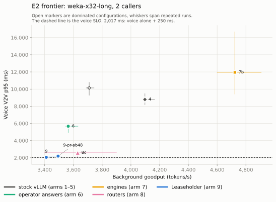

# One GPU, two clocks: a voice agent beside coding agents

A voice agent and a fleet of coding agents can share one GPU only if the GPU answers a voice turn on speech time, about a second after the caller stops talking, while the agents run on tool time, with seconds to minutes between their turns. This is how Leaseholder measured what sharing costs on one RTX 5060 Ti 16 GB, what stock vLLM and the alternatives an operator can deploy today do about it, where they stop, the scheduler change that closes most of the gap, and which of Leaseholder's own mechanisms paid for themselves. Every number comes from a scripted run in this repository; [the last section](#how-the-runs-were-made) says how to rerun them, and [BENCHMARKS.md](BENCHMARKS.md) has every run.

## The box

One RTX 5060 Ti 16 GB (sm_120) on PCIe Gen3 x8, in a host with two Xeon E5-2609 v4 at 1.7 GHz and 188 GiB of RAM. On it, the frozen box: one pinned configuration every experiment runs on.
- **LLM:** vLLM 0.32.0 serving Qwen3-4B-Instruct-2507-FP8 with a 32k context. The KV pool is fixed at 5 GiB, 36,400 tokens: two or three coding-agent contexts. Prefix caching, priority scheduling, and a step cap of 512 tokens with a 256-token long-prefill threshold.
- **CPU tier:** vLLM's native `OffloadingConnector`, 20 GiB in `/dev/shm`, written through (generated tokens too).
- **Audio on the same card:** Whisper large-v3-turbo (STT) on vLLM and Kokoro-82M (TTS), time-sliced with the LLM. This is the edge pattern; NVIDIA's single-GPU voice-agent profile co-locates the same three.

A second, identical card (Gray) is deployed the same way for the two-node points, which wait for a free window on it ([below](#two-gpus-dedicate-or-pool)). No datacenter GPU was available: other hardware is placed on the results by a model, labeled as such.

## What an agent turn costs to resume (E0)

`lh-bench tiers` sends a unique prompt three ways and reads vLLM's prefix-cache counters around each request, to verify where its tokens came from:

| Prompt tokens | Recomputed | GPU prefix-cache hit | Restored from host RAM |
|---|---:|---:|---:|
| 4,096 | 437 ms | 48 ms | 157 ms |
| 16,384 | 3,264 ms | 97 ms | 509 ms |
| 31,744 | 10,239 ms | 156 ms | 903 ms |

- A restore adds about 10 ms plus 23.6 µs a token over a GPU hit: 6.2 GB/s of KV, 79% of what PCIe Gen3 x8 carries. It is bound by the link.
- Recompute is 48 ms + 63 µs a token + 8.1 ns a token squared; the quadratic term is attention.
- Restoring beats recomputing at every length measured, so for agents the CPU tier turns an eviction into a restore rather than a recompute.

The same costs say why voice suffers beside agents: a 512-token prefill chunk after a 30k-token context takes about 270 ms of GPU time, seven times one after an empty context. A voice turn waiting behind agent chunks waits behind time, not tokens.

## Voice under agent load (E2)

### How a point is measured

- **Voice.** Two synthesized callers (`lh-voice bots`) call a stock LiveKit Agents 1.8.8 voice agent through a LiveKit server on the control host, 25 turns each, barging in on a quarter of the turns. Voice-to-voice latency (V2V) runs from the end of the caller's speech to the agent's first audio, read from waveforms at the caller on one clock. A turn the agent does not answer within 30 s counts at 30 s. Turns end a fixed delay after speech, the same for every arm: LiveKit's end-of-turn model judged about one synthesized line in six unfinished and waited its 3 s maximum.
- **Agents.** AIPerf replays the SemiAnalysis Claude Code traces closed-loop as background requests, block-scaled 32× so that every request fits the 32k context, with their subagents and think times capped at 120 s.
- **Records.** Per point: the callers' turns, AIPerf's records, the gateway's request log (realtime first bytes exact to the millisecond), the voice worker's per-turn stage times, the GPU's clocks and temperature once a second, and the engine's and gateway's metrics before and after.
- **Goodput.** Background goodput counts the prompt and completion tokens of the agent requests that completed during the calls. Shed or failed work counts as lost.
- **The SLO.** V2V p95 at most 250 ms above voice alone with as many callers: voice alone was measured five times (1,744–1,805 ms, median 1,767), so the SLO is 2,017 ms.

### The arms

Each baseline is what an operator could deploy today, configured as its authors recommend, on the same engine and model:

| Arm | What it is |
|---|---|
| 1 | Voice alone: the SLO's reference |
| 2 | Stock vLLM: FCFS, default chunking |
| 3 | Priority scheduling, voice at priority 0 |
| 4 | Arm 3 tuned: step cap and long-prefill threshold swept (the frozen box is the best cell) |
| 5 | vLLM's own headroom knobs: `--watermark`, `--max-num-queued-tokens` |
| 6 | A static background concurrency cap; an equal-size static KV reservation in the gateway |
| 7a | vLLM with #54530 (priority preemption at the request-count cap) ported to 0.32.0 |
| 7b | SGLang 0.5.22 with priority preemption, with and without its host tier (HiCache) |
| 8a | llm-d's flow control, emulated in the gateway and labeled so |
| 8b | SMG 1.13.0's priority scheduler, as shipped |
| 8c | Abort-and-resubmit of background work before its first byte (preempt-resubmit) |
| 9 | Leaseholder: the engine change, and a gateway policy timed by the call's lifecycle ([below](#leaseholder-arm-9)) |

### Where the pool has room: the standard scenario

The whole corpus at 8, 16 and 24 agent session trees. At 8, W2's vLLM arms meet the SLO, and arm 9, run there once in W4, lands 43 ms above it. At 16, the realistic operating point, none clearly does: the best land 87–198 ms above it and within noise of each other, and no gateway policy or engine knob separates itself from tuned stock. At 24 none meets it. Repeated three times at 16, arm 9 (2,196 ms) and the frozen box (2,323 ms) are within noise of each other: where the pool has room the KV preemption has nothing to do, a full reply outruns the 16-token window, and what remains is agent prefill sharing the steps of the reply.

### Where agent KV fills the pool: the discriminating scenario

24 session trees of the 48 traces with the largest contexts (a median of 13.3k tokens a request). The pool holds two or three of these contexts, and under the frozen box about 95% of the agents' prompt tokens are computed rather than read from a cache. Here every stock, engine and router baseline but one collapses, with a V2V p95 of 5.7–12.1 s:
- **The loss is the wait for the first sentence.** Endpointing and TTS barely move; on the frozen box the reply's first sentence takes 3.8 s of a 5.2 s mean turn, against 0.3 s alone, most of it before the LLM's first token.
- **Engine priority does not reach it.** vLLM's priority scheduling cannot let a waiting request preempt running ones for KV ([#40004](https://github.com/vllm-project/vllm/issues/40004)); #54530 preempts at the request-count cap, which does not bind here; SGLang's priority preemption does not fire on KV either, with or without its host tier.
- **Static answers help or cheat.** A 2,048-token KV reservation halves the tail (5.7 s); concurrency caps do not help, since two contexts fill the pool; vLLM's queue limit refuses the voice turns with the rest (48 of 50 failed).
- **Preempt-resubmit comes closest** at 2.6 s: aborting the background requests that have no first byte yet frees their KV at once, and their resubmissions restore the prefixes already written through to the CPU tier instead of recomputing them. The agents pay in their tail (TTFT p99 160 s against 99), and it cannot reach a request that is already decoding.

### Leaseholder (arm 9)

Arm 9 has two halves and a signal between them:
- **The engine** runs `make-room`, a scheduler change for vLLM 0.32: a waiting request that lacks KV preempts running work of a strictly lower priority (as few as it needs and at most two a step, the lowest priority and the most KV first, their KV kept in the CPU tier); lower-priority prefill sits out the steps of a higher-priority request's first 16 tokens, from the step it fits, through its KV load; and lower classes leave a 2,048-token reserve free. The first two are proposed upstream as vLLM [#63350](https://github.com/vllm-project/vllm/pull/63350) and [#63351](https://github.com/vllm-project/vllm/pull/63351), without the reserve.
- **The gateway** runs Leaseholder's admission policy. From a caller's speech onset it holds back background requests that would leave less than one voice turn of KV (1,024 tokens) free; in the critical window, from the end of the caller's turn to the reply's first audio, it admits background prefill only up to 150 ms of predicted GPU time, priced by a step model fitted on the box; when the headroom was not there it caps the reply at 16 tokens rather than refusing it (degrade); a background request waits at most 10 s.
- **The voice worker** tells the gateway where each call is: speech onset, the end of the turn, the reply's first audio and its end, a barge-in, the call's end.

The engine half took three rounds, each found in a point's stage breakdown and isolated by a probe before it changed:
1. KV preemption alone passed its probe (a voice turn behind two 18k-token requests in a full pool: 4.9 s to the first token on stock vLLM, 0.25–0.32 s with it) and lost the first E2 point to preempt-resubmit (V2V p95 4.3 s against 2.6 s). The stages put the loss between the reply's first token and its first sentence: the agents' 512-token prefill chunks shared every step of the reply.
2. Holding lower-priority prefill for a turn's first tokens fixed the decode (232 ms from first token to first sentence at the median, against 300 ms for preempt-resubmit) and left a first-token tail (p95 2.1 s).
3. The tail was a turn whose prefix the agents had evicted from the GPU between turns, loading back from the CPU tier: once its KV had arrived, it waited for the scheduler's waiting loop, which runs only on budget the running prefills leave. Holding prefill through the load took a synthetic load's call TTFT p95 from 3.2 s to 0.3 s.

The points measured on the first two versions are kept and reported, not placed on the frontier.

### The results

Five runs of each headline configuration and three of each ablation and PR configuration, in rounds that rotate the order of the engine groups, so that no configuration always runs at the same hour; the PRs' configurations ran later, in a session of their own with no control (10-23 23:16Z – 10-24 01:25Z). V2V p95, the median of the runs and their range:

| Configuration | V2V p95 | Background tokens/s | Agent TTFT p99 |
|---|---:|---:|---:|
| The frozen box (tuned stock vLLM) | 10,138 ms (9,257–10,811) | 3,710 | 99 s |
| Static reservation, 2,048 tokens | 5,671 ms (4,906–5,798) | 3,564 | 102 s |
| Preempt-resubmit | 2,591 ms (2,110–2,663) | 3,630 | 160 s |
| Arm 9, every reply capped at 16 tokens | 2,057 ms (1,980–2,134) | 3,411 | 103 s |
| #63350 alone | 5,773 ms (5,612–6,063) | 3,633 | 97 s |
| #63350 + #63351, 16-token window | 3,229 ms (3,220–4,772) | 3,568 | 100 s |
| #63350 + #63351, 48-token window | 2,193 ms (2,168–2,286) | 3,493 | 97 s |

Each configuration at the median of its runs, whiskers over their range. The open diamond is the frozen box; 4 is its best step cap, 6 the static reservation, 7b SGLang with HiCache and 8c preempt-resubmit. Arm 9 (left) and the PRs' configuration with a 48-token window (9-pr-ab48, right) are separate configurations, each measured at one load, so no line joins them.

- **The engine change takes the voice tail to the SLO's edge.** With full replies and a 48-token window, the PRs' configuration is 176 ms over the SLO (2,193 ms). Arm 9, whose gateway capped every reply at 16 tokens, is 40 ms over it at the median, and two of its five runs are under it. No configuration without the engine change has a run under the SLO.
- **The prefill cap is the necessary half.** Without it the p95 stays at 5.3 s even with the KV preemption and the reserve. Either the KV preemption or the reserve makes the room. With full replies they gave 2,193 ms (the KV preemption, as the PRs) and 2,205 ms (the reserve, with arm 9's policy and a 48-token window). With capped replies the reserve alone gave 2,037 ms and the KV preemption alone 2,116 ms (2,115–2,155, every run above arm 9's median); with both, the reserve kept the pool from filling and the KV preemption never fired (0 preemptions in five runs). #63350 alone gets the turn into the batch, and its reply then decodes beside agent prefill (5.8 s).
- **The reply has to fit the window.** This voice agent's replies run 20 tokens at the median and 39 at most. With a 16-token window, a full reply outruns it and decodes beside agent prefill again: 3.2–4.0 s, with the gateway or without. Degrade capped every reply here, which is what fits arm 9's replies into the window; a 48-token window fits full replies instead, about 140 ms above the capped ones (526 against 429 ms to the first sentence).
- **The agents keep most of their throughput.** Arm 9 keeps 92% of the frozen box's background goodput and the PRs' configuration 94%, with the agents' TTFT p99 unchanged. Preempt-resubmit keeps 98% at a 160 s tail, so neither it nor arm 9 dominates the other on the frontier.

The stages, as a mean over each configuration's replies, show where each fix acts: endpointing and TTS are the same in every row, and the bar that moves is the reply's first sentence.

## What lifecycle timing could and could not do

Leaseholder's premise was that a realtime tier needs to know what is coming: when a caller starts to speak, when an agent's tool returns. Neither experiment found a use for the knowledge a deployment actually has, for different reasons.
- **Agents (E1, in simulation).** Knowing exactly when an agent returns from its tool buys under 9% of resume TTFT at p50 over LRU with the CPU tier: the median resume is already a GPU hit or a short restore, and restores are bound by the link at 6.2 GB/s. At p90 that oracle buys 28% at low pressure, about 80–90 ms, by hiding a restore inside the pause; session history, which is what a deployment knows without the tools' own return times, buys nothing.
- **Voice (E2).** The gateway's lifecycle-timed mechanisms could not act in the regime where voice suffers. Running agent requests held the pool, and a control plane in front can protect KV only by deferring new requests, so the headroom armed at speech onset was never there: degrade capped 60 of 60 realtime requests in every run of arm 9. The critical-window throttle, checked after the headroom, deferred nothing while the headroom ran, even at a 0 ms budget. Leaving out or changing any of these mechanisms therefore landed within the spread of arm 9's runs (medians of 2,033–2,124 ms against 2,057, three runs each), and the same policy in front of the stock engine left voice where stock vLLM does (10,993 ms).

So a control plane in front cannot make room for a voice turn while running work holds the KV; only the engine can, by preempting that work. This does not show that lifecycle timing never helps: where its mechanisms engage, as in the standard scenario at 24 session trees, where the throttle deferred 27 requests, they were not isolated from the engine change.

What did pay is scheduling: the engine running a realtime request's admission, KV load and first tokens without lower-priority prefill beside them, and a reply that fits that window. [PRODUCTION.md](PRODUCTION.md) turns that into a configuration to deploy.

## What transfers to other hardware

The arms' behavior is stated in hardware-free coordinates: KV pressure (the live working set over the pool), π (the median pause over the restore time) and ρ (restore over recompute at the median prompt). `lh-sim hardware` places an L4 and an H100 SXM on the same map, with the box's measured costs scaled by the ratios of their published peaks (bandwidth for the weight and KV reads, FP8 for the linear layers, BF16 for attention, the link for restores). The model's restores on PCIe Gen4 match vLLM's published L20 measurement within 10%.

The regime where a waiting voice turn is blocked by KV (#40004) follows how long the agents' contexts are against the pool, and how much of the pool the realtime tier needs, not the consumer card. On the 32× replay, running agents leave two calls short of KV 12% of the time at 24 sessions on the box, at most 1% of the time up to 24 sessions on the L4, and never on the H100. Replayed at each GPU's own scaling (the L4 at 16×, the H100 at 4×), the L4 is short 9–21% of the time at 16–32 sessions and the H100 0–7%, or 25–65% for a realtime tier sized to the box's share of the pool. Everything off the box is modeled.

## Two GPUs: dedicate or pool

Three configurations of two GPU nodes: a voice node and an agent node (dedicate); two mixed nodes with least-loaded placement; two mixed nodes with Leaseholder's placement, which sends a new call to the node with the fewest calls and a new agent session to the node holding the least background KV. The gateway places sessions on several nodes and keeps each on its node, the harness measures a point on two nodes with each node's share, and both are deployed. The points are not measured yet: they wait for a window on the second card ([EXPERIMENTS.md](EXPERIMENTS.md#e2-voice-under-agent-load)).

## How the runs were made

- **One frozen box**, pinned by lock files and model revisions. Engine variants are drop-ins switched by one script, and runs are grouped by engine because a restart costs minutes.
- **Campaign files** list arm files; [`benchmarks/e2/campaign.sh`](../benchmarks/e2/campaign.sh) measures them in order from a workstation, fetches each run directory and writes the report. A stopped campaign resumes where it stopped. While it measures, only the box's own units may hold the GPU, and a point measured while another process did is measured again ([the runbook](../ops/RUNBOOK.md#checks-before-heavy-work-on-a-shared-host)).
- **Repeats are rounds**: each round is a campaign over the headline configurations, with the engine groups' order rotated. Results are reported per run with their spread, never as a mean alone.
- **Control-plane overhead.** The gateway's own time is a metric on every request (`lh_gateway_overhead_seconds`: a p99 of 0.44–0.58 ms in place on cyan). Paired against the engine's own socket, on the W1 build, the gateway added 0.38 ms to a voice request's first token.
- **Reproduce.** `make reproduce-e2` rebuilds the report, its tables, frontiers and waterfall from the compact records of all 129 points ([`benchmarks/results`](../benchmarks/results/2026-10-23-e2/README.md)), and `make e2-figures` the figures above; `make reproduce-e1` rebuilds E1's tables from the 32× corpus, and `make reproduce-calibration` the simulator's calibration from its runs' exports. The exports and E2's raw run directories are assets of the v0.3 release, with the demo video: two calls side by side, the frozen box's and the PRs' configuration, measured again for it with the calls' audio saved (V2V p95 10,851 and 2,202 ms, not in the tables).

## Limitations

- One model (Qwen3-4B-FP8), one GPU model, one host; synthesized callers and fixed endpointing.
- 50 turns a point: a p95 lies between the third- and fourth-largest turn, so single runs differ by a few hundred milliseconds; a configuration near the SLO moves about 150 ms from run to run, one that misses it up to 1.9 s, and SGLang 7 s.
- The agent traces are block-scaled 32×, which keeps their reuse structure and changes their timing.
- Every turn counts, the first of each call included, which is slower under load: without it, the standard scenario's p95 at 16 session trees drops from 2,323 to 2,186 ms for the frozen box. Background goodput is counted over the calls, whose duration differs by configuration.
- vLLM counts a preemption when the victim next produces output, so per-point preemption counts are lower bounds.
- Every run replays the same workload sample (agent seed 11, caller seed 0): the ranges are timing noise, not workload variation.
- The vLLM PRs' configurations ran in a session of their own, after the rounds and with no control (10-23 23:16Z – 10-24 01:25Z).
- vLLM 0.32's prompt-token counters see only a request's first scheduling: what a preempted request reloads or recomputes when it resumes is not in them. The records also keep the CPU tier's own load counter, which sees a resume's loads; what a resume recomputes is not measured.
- The two-node points are not measured yet.
